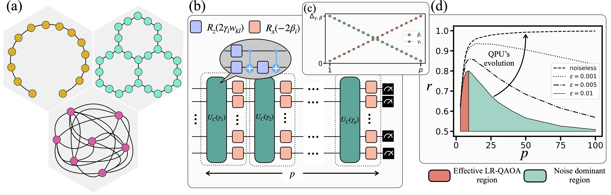
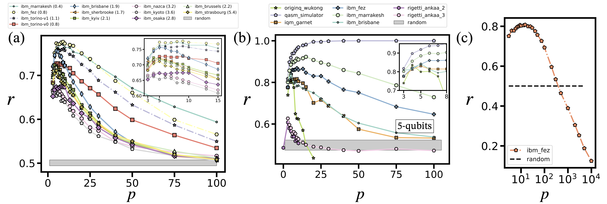
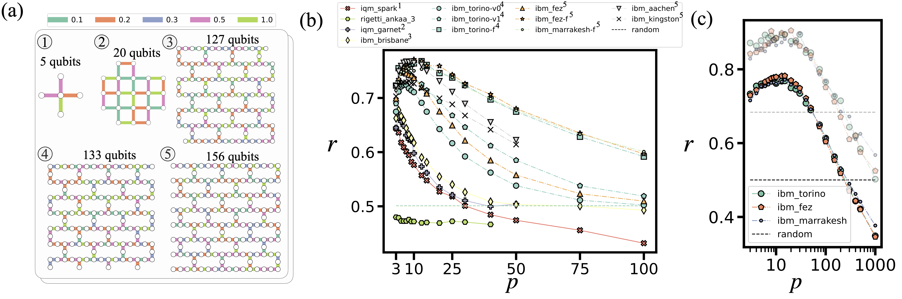
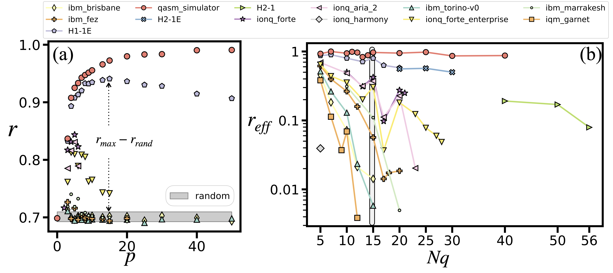

# LR-QAOA

## Motivation

As quantum processing units (QPUs) surpass the exact classical simulation limit, noise still hinders their practical utility. With increasing qubit counts and circuit depths, there is a pressing need for scalable, interpretable, and platform-agnostic tools that reflect meaningful progress of QPUs performance. The linear-ramp quantum approximate optimization algorithm (LR-QAOA) addresses this by offering a deterministic, non-variational QAOA protocol that gives an estimate of the usable circuit depth of a QPU. 

## Protocol

In this work, we use the **Linear Ramp Quantum Approximate Optimization Algorithm (LR-QAOA)** [[1]](https://arxiv.org/abs/2405.09169) protocol, a fixed **Quantum Approximate Optimization Algorithm (QAOA)** protocol, as an easy-to-implement, scalable benchmarking methodology. This approach assesses **Quantum Processing Units (QPUs)** at different **widths (number of qubits)** and **2-qubit gate depths**. 


Scheme of the Quantum Processing Units (QPUs) benchmarking. (a) Graphs topologies used for the benchmarking, i.e., the qubit connectivity needed to run the algorithm. In yellow is the 1D-Chain, in green is the native layout (NL), and in pink is the fully connected (FC) graph. (b) QAOA protocol consists of alternating layers of the problem Hamiltonian and the mixer Hamiltonian. $p$ represents the depth of the algorithm.
The parameters used in these unitaries follow a linear ramp schedule, as shown in (c), which approximates adiabatic evolution via first-order Trotterization. $\Delta_{\gamma, \beta}/p$ is the slope. (d) illustrates the typical behavior of the approximation ratio $r$ as a function of depth $p$ under different depolarizing noise levels $\varepsilon$.
The red region corresponds to algorithm-dominated performance, and the green region to noise-dominated behavior.
As devices improve, we expect the crossover between these regions to occur at larger $p$.

We benchmark quantum devices by solving instances of the weighted maxcut problem using LR-QAOA. The key performance metric is the approximation ratio $r$, which increases with depth and saturates at 1 in the absence of noise, degrading as coherence is lost. LR-QAOA quantifies a QPU’s ability to preserve a coherent signal as circuit depth increases, identifying when performance becomes statistically indistinguishable from random sampling.  


## Assumptions

- **A fixed, well-conditioned schedule.** The angles follow a linear ramp, γ<sub>k</sub> = kΔ/p and β<sub>k</sub> = (p − k + 1)Δ/p, with the slope Δ chosen per graph type and size (fully connected: 0.63 up to 17 nodes, 0.3 up to 45, 0.2 above; 1D chain: 1.0, or 0.75 with fractional gates; native layout: 0.75). These values make the noiseless approximation ratio grow with p. If Δ is poorly chosen, r grows slowly even without noise, and a failing run says more about the schedule than about the hardware.
- **Known optimum.** Each instance is a weighted MaxCut problem (weights drawn from {0.1, 0.2, 0.3, 0.5, 1}) whose optimal cut is computed exactly, so r is an absolute measure.
- **Uniform random sampling as the null model.** The baseline is the approximation ratio of the same number of uniformly random bitstrings. A run passes when r exceeds the random mean with a one-sided p-value below 10<sup>−3</sup>; plots show the random mean + 3σ (99.73%) threshold. A fully depolarised device produces exactly this distribution, so passing means some coherent signal survived.
- **Same circuit on every platform, compiled natively.** Each vendor's stack decides how to route and decompose the circuit (SWAP networks on fixed-coupling chips, direct gates on all-to-all devices, fractional gates where available), so the benchmark measures the whole stack, not the bare qubits.

## Limitations

- **Signal, not usefulness.** Passing shows the output is distinguishable from random sampling. It does not show that the device solves MaxCut better than a classical heuristic.
- **One instance per size.** Each width uses a single problem instance, so instance-to-instance variation is not averaged out.
- **Look-elsewhere effect.** When several copies of a problem run in parallel on one chip, or several depths are tried, reporting the best one raises the chance of a false pass near the threshold. Borderline passes should be checked by re-running or by pooling the copies.
- **Native-layout results are not comparable across lattices.** The native-layout problem graph is the device's own coupling map, so heavy-hex chips (2–3 neighbours per qubit) and square lattices (up to 4) solve different problems.
- **No time or cost dimension.** r says nothing about how long a circuit takes or how many shots it needs; a slow but accurate device and a fast but noisy one can look similar.

## Extensions

- **Fractional gates.** Running RZZ(θ) directly instead of two CNOTs per coupling, on devices that support it, reaching p = 10,000 on a 100-qubit 1D chain.
- **Square-lattice ladders.** On square-lattice chips (IBM Nighthawk), a fully connected problem can run on a 2 × m ladder, about 17% shallower than the 1D SWAP network.
- **Layer time.** The time one fully connected layer takes on each processor, computed from calibrated gate durations or estimated from vendor-published timings. It is shown on the website next to the results.

## Implementation

- [LR-QAOA-QPU-Benchmarking](https://github.com/alejomonbar/LR-QAOA-QPU-Benchmarking)

## Results

Up-to-date results for every processor, with interactive plots and a downloadable JSON file, are on the website: <https://alejomonbar.github.io/LR-QAOA-QPU-Benchmarking/>. The figures below are from the paper [2].

### 1D-Chain

The 1D-chain benchmark evaluates how well a QPU preserves the algorithmic signal as LR-QAOA depth increases along a linear qubit chain. This topology isolates the impact of circuit depth from layout constraints. We use the 99.73\% confidence threshold from a random sampler to define benchmark pass/fail behavior.

<div class="center">
   
</div>
Approximation ratio versus number of LR-QAOA layers for 1D-chain WMC problems on IBM, IQM, Rigetti, and OriginQ devices.
(a) Performance on a 100-qubit problem across IBM Eagle and Heron QPUs. Numbers in parentheses indicate EPLG at the time of execution.(b) Cross-platform comparison for a 5-qubit problem run on different QPUs.
(c) Scaling study on *ibm_fez* from $p=3$ to $p=10,000$, reaching 990,000 ZZ gates at the deepest layer using fractional gates. The dashed line in (c) marks the expected approximation ratio of a random sampler.

### Native Layout

The NL benchmark stresses system-wide performance by employing all qubits and native couplers in each device’s layout.  
A QPU is considered to pass at a given depth $p$ if the observed approximation ratio $r$ exceeds the 99.73\% confidence threshold of the random-sampler baseline. Among all tested platforms, only *rigetti_ankaa_3* fails to pass the benchmark at any depth. The best-performing devices are *ibm_fez*, *ibm_marrakesh*, and *ibm_torino*, all of which support fractional gates. Interestingly, *ibm_aachen* achieves a comparable performance peak despite lacking fractional gate support, implying that it could potentially outperform the other devices once fractional gates become available on this QPU. 

<div class="center">
   
</div>


NL-based benchmarking using LR-QAOA for WMC problems on *iqm_spark*, *iqm_garnet*, *rigetti_ankaa_3*, *ibm_brisbane*, *ibm_torino*, and *ibm_fez*/*ibm_marrakesh*/*ibm_aachen*/*ibm_kingston*. 
Problem sizes (with number of edges in parentheses) are: 5 (4), 20 (30), 82 (138), 127 (144), 133 (150), and 156 (176).
(a) QPU layouts used in each experiment. 
Nodes represent qubits, and edges represent native two-qubit connectivity. 
Edge colors denote the WMC instance weights, randomly chosen from \{0.1, 0.2, 0.3, 0.5, 1\}, as shown at the top.
(b) Approximation ratio versus number of LR-QAOA layers $p$ for each processor.
The dashed horizontal line indicates the random-sampler baseline.
Labels with an 'f' suffix, e.g., *ibm_marrakesh*-f, denote experiments using fractional gates.
(c) Scaling experiment with up to $p = 1,000$ LR-QAOA layers using fractional gates.
Semitransparent points mark the sample with the maximum approximation ratio observed.

### Fully Connected
The FC benchmark imposes the highest stress by combining maximal depth and full-qubit connectivity, making it the toughest test of QPU coherence and routing capabilities.  A device passes if its approximation ratio $r$ exceeds the 99.73\% confidence interval of the random sampler baseline at any $p$. Since the approximation ratio achieved by random guessing increases with problem size, we normalize the approximation ratio to quantify the gain over random guessing, and denote this normalized metric as $r_{\text{eff}}$.

<div class="center">
   
</div>
Fully connected (FC) benchmarking using LR-QAOA for WMC problems with 5 to 56 qubits. 
(a) Approximation ratio $r$ versus LR-QAOA depth $p$ for a 15-qubit instance. 
Shaded region denotes the 99.73\% confidence interval of a random sampler. 
(b) Effective approximation ratio $r_{\mathrm{eff}}$ versus problem size for multiple QPUs. 
Each point reflects the best-performing depth not within the random region.

## References

[1] J. A. Montanez-Barrera and K. Michielsen, *Towards a universal QAOA protocol: Evidence of a scaling advantage in solving some combinatorial optimization problems*, [arXiv:2405.09169](https://arxiv.org/abs/2405.09169) (2024).

[2] J. A. Montanez-Barrera, K. Michielsen and D. E. Bernal Neira, *Evaluating the performance of quantum processing units at large width and depth*, [arXiv:2502.06471](https://arxiv.org/abs/2502.06471) (2025).

```bibtex
@misc{montanezbarrera2024universal,
    title={Towards a universal QAOA protocol: Evidence of a scaling advantage in solving some combinatorial optimization problems},
    author={J. A. Montanez-Barrera and Kristel Michielsen},
    year={2024},
    eprint={2405.09169},
    archivePrefix={arXiv},
    primaryClass={quant-ph}
}

@misc{montanezbarrera2025evaluating,
    title={Evaluating the performance of quantum processing units at large width and depth},
    author={J. A. Montanez-Barrera and Kristel Michielsen and David E. Bernal Neira},
    year={2025},
    eprint={2502.06471},
    archivePrefix={arXiv},
    primaryClass={quant-ph}
}
```
