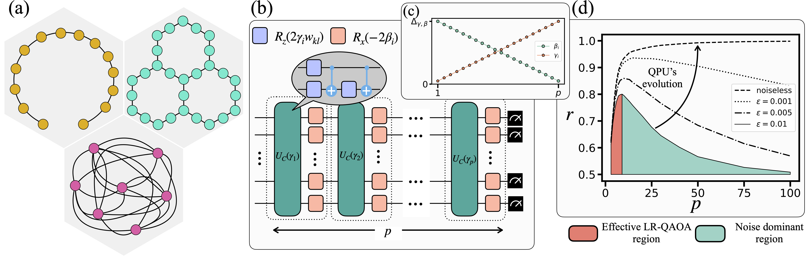

# Quantum Computing Benchmarking with LR-QAOA: Evaluating the performance of quantum processing units at large width and depth
Paper:https://arxiv.org/abs/2502.06471

## Overview
Currently, we are in a stage where quantum computers surpass the size that can be simulated exactly on classical computers, and noise is the central issue in extracting their full potential. Effective ways to characterize and measure their progress for practical applications are needed.

In this work, we use the **Linear Ramp Quantum Approximate Optimization Algorithm (LR-QAOA)** [[1]](https://arxiv.org/abs/2405.09169) protocol, a fixed **Quantum Approximate Optimization Algorithm (QAOA)** protocol, as an easy-to-implement, scalable benchmarking methodology. This approach assesses **Quantum Processing Units (QPUs)** at different **widths (number of qubits)** and **2-qubit gate depths**. 


Scheme of the Quantum Processing Units (QPUs) benchmarking. (a) Graphs used for the benchmarking. In yellow is the 1D-Chain, in green is the native layout (NL), and in pink is the fully connected (FC) graph. (b) QAOA protocol consists of alternating layers of the problem Hamiltonian and the mixer Hamiltonian. $p$ represents the depth of the algorithm. (c) Schedule of the LR-QAOA algorithm, $\Delta_{\gamma, \beta}/p$ is the slope. (d) Expected results of LR-QAOA in terms of approximation ratio versus number of LR-QAOA layers. Black curves represent different levels of depolarizing noise strength.

The benchmarking identifies the depth at which a **fully mixed state** is reached, meaning results become indistinguishable from those of a random sampler.

### **Tested Systems & Vendors**
We evaluate this methodology using **three graph topologies**:
- **1D-chain**
- **Native Layout (NL)**
- **Fully Connected (FC)**  

These experiments were conducted on **28 QPUs** from **7 vendors**:  
✅ AQT  
✅ IBM  
✅ IQM  
✅ IonQ  
✅ Quantinuum  
✅ Rigetti  
✅ OriginQ 


### **Key Findings**
- The largest problem tested: **1D-chain with \( p = 10,000 \)** involving **990,000 2-qubit gates on `ibm_fez`**.
- **`ibm_fez` performs best** for **1D-chain & native layout**, retaining coherence at **\( p=200 \)** with **35,200 fractional 2-qubit gates**.
- **`quantinuum_H2-1` performs best** for **fully connected graphs**, successfully passing the test at **\( N_q=56 \) qubits, \( p=3 \) (4,620 2-qubit gates)**.

---

## 🌐 **Website**

Live results: **https://alejomonbar.github.io/LR-QAOA-QPU-Benchmarking/** (static site in [`site/`](./site), published by [GitHub Actions](./.github/workflows/site.yml)).

**Publishing a new result** takes no code changes:

1. Run it with `python -m lrqaoa` (see [Running a benchmark](#️-running-a-benchmark)), which saves `Data/<backend>/<N>_<FC|1D|NL>.npy`. Files saved by hand with the usual dict (`postprocessing`, `random`, `ps`, `Deltas`, …) work too.
2. If the backend is new, add a line for it under `devices` in [`Data/registry.json`](./Data/registry.json) (name, vendor, modality). Without it, the build guesses the metadata and prints a warning.
3. Commit and push to `main`. The workflow runs [`scripts/build_site_data.py`](./scripts/build_site_data.py), which finds every result file, computes the random baseline, pass/fail and gate counts, and redeploys the page. A result's date is `results["date"]` (`"YYYY-MM-DD"`) if the file stores one, otherwise the date the file was first committed.

Files with other names (variants, repeated runs) are only published when listed under `extra_files` in the registry. To preview locally:

```bash
python scripts/build_site_data.py && python -m http.server -d site 8000   # open http://localhost:8000
```

---

## ▶️ **Running a benchmark**

The [`lrqaoa`](./lrqaoa) package runs the whole protocol on any supported device: it picks the problem
from the shared banks in `Data/`, builds the LR-QAOA circuits, maps them onto the chip, submits them,
and later scores the results. Each run is described by a short config file (examples in [`configs/`](./configs)):

```toml
backend  = "ibm_pittsburgh"   # also the folder name in Data/ and the name on the website
topology = "FC"               # FC | 1D | NL
nq       = 20
ps       = [3, 4, 5]          # LR-QAOA layers
deltas   = [0.3]              # ramp slope (optional: paper default per size)
shots    = 1000

[provider]
kind    = "ibm"               # ibm | braket | iqm | quantinuum | aer
service = "mcm-primitives"    # saved QiskitRuntimeService account
```

```bash
python -m lrqaoa run configs/ibm_fc.toml --dry-run   # compile only: depth and 2-qubit gates per p
python -m lrqaoa run configs/ibm_fc.toml             # submit; saves Data/ibm_pittsburgh/20_FC.npy (status: submitted)
python -m lrqaoa status                               # job status of every submitted run
python -m lrqaoa collect --all                        # fetch finished jobs, compute r and the random baseline
git add Data && git commit -m "results" && git push   # the website updates itself
```

Flags override the file, or replace it: `python -m lrqaoa run --backend qasm_simulator --topology FC --nq 10 --ps 3 5 10`.

**Several sizes at once:** give a list, `nq = [5, 7, 10, 15, 20]` (or `--nq 5 7 10 15 20`). The whole sweep is
submitted as one job, so it waits in the queue once, and each size still gets its own results file. Slopes can
be set per size with a `[deltas]` table (`"20" = [0.3]`). Add `--skip-existing` to run only the sizes that are
not in `Data/` yet.

| Provider (`kind`) | Devices | Needs |
|---|---|---|
| `ibm` | IBM Quantum (`ibm_*`) | `qiskit-ibm-runtime`, saved account |
| `braket` | IonQ, AQT, Rigetti, IQM on AWS (`ionq_*`, `aqt_*`, `rigetti_*`, `iqm_*`) | `qiskit-braket-provider`, AWS credentials |
| `iqm` | IQM Resonance | `qiskit-iqm`, token in `RESONANCE_API_TOKEN` |
| `quantinuum` | Helios via Nexus (Guppy programs) | `qnexus`, `guppylang`, `qnx.login()` |
| `aer` | `qasm_simulator`, `qiskit_mps`, `fake_<ibm device>` (noisy) | `qiskit-aer` |

What it does for you:
- **Same problems everywhere.** Instances come from `Data/WMC_FC.npy`, `Data/problems_1DChain.npy` and
  `Data/NL-problems.npy`; `python -m lrqaoa new-problem FC --nq 40` (or `NL --backend <device>`) adds one.
- **Layout.** FC uses a SWAP network on a qubit line (or `strategy = "ladder"` on square lattices,
  `all_to_all` on trapped ions); 1D chains and FC copies fill the chip in parallel sections. Devices
  without a stored line get one found in their coupling map.
- **Safe files.** Results go to `Data/<backend>/<N>_<TOPO><tag>.npy` in the same format as the notebook
  era, plus `date`, `status` and `meta` (config, layout, gate counts, SDK versions). Existing files are
  never overwritten without `--force`; use `tag = "_v2"` for repeats.

Run the tests with `python -m pytest`: they check that every circuit
matches the original notebook circuit exactly, that scoring reproduces the stored results, and run
full benchmarks on local simulators.

---

## 📂 **Repository Structure**

```
LR-QAOA-QPU-Benchmarking/
├── lrqaoa/                 # Benchmark package: circuits, layouts, devices, scoring, CLI
├── configs/                # Example run configs, one per platform
├── tests/                  # Circuit equivalence and end-to-end tests
├── examples/               # The original research notebooks (experiments and paper figures)
├── Data/                   # Problem banks, results (Data/<backend>/<N>_<TOPO>.npy), registry.json
├── Figures/                # Figures made by the notebooks
├── site/                   # Website (built from Data/ by scripts/build_site_data.py)
├── scripts/                # Website data builder
├── LR-QAOA-Benchmark.md    # Detailed benchmark protocol documentation
└── requirements.txt        # Python environment used for the paper
```

---

## 📑 **Notebooks** (in [`examples/`](./examples), run from the repository root)
### **1D-Chain Experiments**
- [1D-Chain-Experiments.ipynb](./examples/1D-Chain-Experiments.ipynb) - Experimental results for 1D-chain topology.
- [1D-Chain-Figures.ipynb](./examples/1D-Chain-Figures.ipynb) - Visualizations and analysis for 1D-chain topology.
- [1D-Chain-Origin-Quantum.ipynb](./examples/1D-Chain-Origin-Quantum.ipynb) - 1D-chain experiments on Origin Quantum QPU.

### **Fully Connected (FC) Experiments**
- [FC-Experiments.ipynb](./examples/FC-Experiments.ipynb) - Experimental results for fully connected graphs.
- [FC-Figures.ipynb](./examples/FC-Figures.ipynb) - Figures and visualizations for fully connected experiments.
- [FC_nexus.ipynb](./examples/FC_nexus.ipynb) - Fully connected runs on Quantinuum Helios through Nexus.

### **Native Layout (NL) Experiments**
- [NL-Experiments.ipynb](./examples/NL-Experiments.ipynb) - Experimental results for native layout graphs.
- [NL-Figures.ipynb](./examples/NL-Figures.ipynb) - Visualizations and analysis for native layout graphs.

### **Additional Notebooks**
- [generate_problems.ipynb](./examples/generate_problems.ipynb) - Generate the random graphs used for the FC, NL, and 1D-Chain experiments.
- [Figures_sampling.ipynb](./examples/Figures_sampling.ipynb) - Sampling-related figures and analysis.

### **Dependencies**
- [requirements.txt](./requirements.txt) - Required Python libraries for running the notebooks.

---

## 🚀 **Getting Started**
1. **Clone the repository:**
   ```bash
   git clone https://github.com/alejomonbar/LR-QAOA-QPU-Benchmarking.git

